 

  

<!-- Optional photo: add your own image URL here.

 -->

## About

I build web interfaces and the servers behind them. Right now I'm learning **advanced React** and **backend development with Node.js**, and I'm turning what I learn into projects.

Ask me about HTML, CSS, JavaScript, React and Tailwind CSS.

Fun fact: coding is my passion, and I enjoy learning new tech every day.

## Skill universe

Text version of the skill universe

| Orbit | Skills | Status |
| --- | --- | --- |
| Frontend | HTML, CSS, JavaScript, React.js, Tailwind CSS | Working knowledge |
| Frontend | Next.js, TypeScript | Learning |
| Backend | Node.js, Express.js, REST APIs, authentication, server-side development | Learning |
| Database | MongoDB | Learning |
| Tools | Git, GitHub, VS Code, npm, Vercel | Working knowledge |
| Creative tech | Framer Motion, GSAP, Three.js, React Three Fiber | Learning |

&nbsp;
&nbsp;
&nbsp;
&nbsp;
&nbsp;
&nbsp;
&nbsp;
&nbsp;

## Journey

- **Foundations:** HTML, CSS and JavaScript.
- **Building interfaces:** React and Tailwind CSS.
- **Now:** advanced React and backend development with Node.js.
- **Next:** 3D and motion on the web with Three.js, React Three Fiber, Framer Motion and GSAP.

## Projects

<!-- TODO: replace each row with a real repository and, if it exists, a live demo. -->

| Project | What it is | Stack | Links |
| --- | --- | --- | --- |
| _Project name_ | One sentence on what it does | React, Tailwind CSS | [Code](https://github.com/jihadhosenp-gif/REPO_NAME) / [Demo](https://YOUR_DEMO_URL) |
| _Project name_ | One sentence on what it does | Node.js, MongoDB | [Code](https://github.com/jihadhosenp-gif/REPO_NAME) |

All repositories: [github.com/jihadhosenp-gif](https://github.com/jihadhosenp-gif?tab=repositories)

## GitHub activity

## Fun corner

A few things about how I work

- I learn by building: every new concept goes into a small project.
- I read error messages twice before asking for help.
- I like interfaces that feel alive, which is why I'm exploring 3D and motion.
- Coding is my passion, and I enjoy learning new tech every day.

Currently on my list

- [ ] Ship a full-stack project with React, Node.js and MongoDB
- [ ] Build my first Three.js scene
- [ ] Write my first article
- [x] Create this profile

<!-- Contribution snake: after adding .github/workflows/snake.yml, run it once from the Actions tab, then uncomment.

<picture>
<source media="(prefers-color-scheme: dark)" srcset="https://raw.githubusercontent.com/jihadhosenp-gif/jihadhosenp-gif/output/github-snake-dark.svg" />

</picture>

 -->

## Connect

 Jin 

